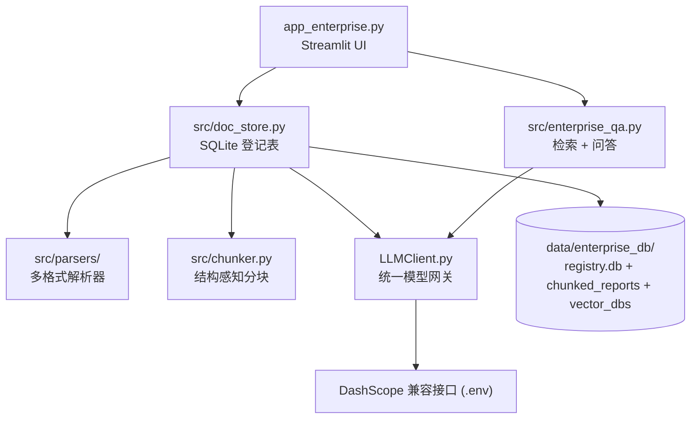

# 企业知识库 RAG 问答系统

多格式文档入库 + 全库检索 + LLM 结构化问答，答案强制附带**文件名 + 行号**级来源引用，资料不足时明确拒答。

## 功能特性

- **多格式入库**：`pdf / doc / docx / txt / md / markdown / json / xlsx / xls / csv`，PDF 走本地 MinerU（GPU 自动检测）
- **结构感知分块**：按 markdown 标题层级切节，表格原子化（超长表按行分组并重复表头），每块带【文档标题 › 章节路径】前缀
- **单文件生命周期管理**：`doc_id = 文件内容 sha1`，同内容幂等跳过，文件更新自动清旧版本产物——单文件换代，无需全量重跑
- **全库统一检索**：跨文档向量召回（faiss IndexFlatIP + L2 归一化）→ gte-rerank-v2 真实重排 → 0.7/0.3 加权融合
- **结构化问答**：qwen 系大模型输出「分步推理 / 推理摘要 / 最终答案 / 引用来源」，function calling 失败自动降级 json_mode + json_repair
- **来源溯源**：块携带原文绝对行号，答案引用回填为「文件名（类型，行 X-Y）」
- **防编造**：prompt 强制「严格依据检索资料，不足时明确说资料中未提及」

## 架构



所有模型调用（对话 / 向量 / 重排）收敛到 `LLMClient.py` 一个出口，切换网关只需改 `.env` 的 `api_base_url`，代码零改动。

## 快速开始

### 1. 环境与依赖

```bash
python -m venv venv
venv\Scripts\pip install -r requirements.txt
```

> 注意：`requirements.txt` 继承自旧项目，其中 docling、google-*、rank-bm25 等为旧管道遗留；
> 当前链路核心依赖为 `streamlit / faiss-cpu / langchain / langchain-openai / openai / dashscope /
> pydantic / python-dotenv / json_repair / tenacity / pandas / openpyxl / python-docx`，
> PDF 解析另需本地部署 [MinerU(magic_pdf)](https://github.com/opendatalab/MinerU) 及其模型（已置于 `modelscope_models/`）。

### 2. 配置 `.env`（项目根目录）

```ini
api_base_url=https://dashscope.aliyuncs.com/compatible-mode/v1   # OpenAI 兼容网关
api_key=sk-xxx
model=qwen3.7-max        # 问答大模型
# embedding 固定 text-embedding-v1（1536 维）；重排固定 gte-rerank-v2
```

### 3. 启动

```bash
venv\Scripts\python.exe -m streamlit run app_enterprise.py --server.port 8502
```

浏览器打开 <http://localhost:8502>。

## 使用说明

**左侧 · 文档管理**：上传文件（可多选）→ 点「入库所选文件」；清单展示每篇状态（ready/failed/块数/错误）；选中某篇可重建或删除，操作后问答后端缓存自动刷新。

**左侧 · 查询设置**：输入问题，可选限定文档类型（固定列出全部支持格式，并标注库内已有类型）、调整 Top-K、开关重排；

- 【🔎 搜索文档】只看检索结果（每块附文件、行号、向量/重排/综合三路分数）
- 【🚀 生成答案】走完整链路，输出分步推理、推理摘要、引用来源与最终答案

## 目录结构

```
├── app_enterprise.py        # Streamlit 入口（文档管理 + 查询问答）
├── LLMClient.py             # 统一模型网关：chat / chat_structured / embed / rerank
├── src/
│   ├── parsers/             # 多格式解析器，统一产出 ParseResult(markdown + meta)
│   ├── chunker.py           # 结构感知分块（标题切节 + 表格原子化 + 章节前缀）
│   ├── doc_store.py         # 登记表 + 单文件入库/重建/删除（sha1 幂等）
│   └── enterprise_qa.py     # 全库检索、重排融合、结构化问答与来源回填
├── data/
│   ├── enterprise_db/       # registry.db + chunked_reports/{doc_id}.json + vector_dbs/{doc_id}.faiss
│   ├── uploads/             # UI 上传文件落地
│   └── _parse_test/         # 测试夹具输出
├── modelscope_models/       # MinerU PDF 解析模型（3.6G，勿删）
├── _test_parsers.py         # 验收：解析器
├── _test_docstore.py        # 验收：登记表 + 入库幂等/换代/删除
├── _test_qa.py              # 验收：检索问答（真实 LLM 调用）
└── _test_ui.py              # 验收：UI AppTest 冒烟
```

## 验收测试

```bash
venv\Scripts\python.exe _test_parsers.py
venv\Scripts\python.exe _test_docstore.py
venv\Scripts\python.exe _test_qa.py      # 含真实 LLM 调用
venv\Scripts\python.exe _test_ui.py
```

覆盖：八格式解析、入库幂等与文件换代、faiss 维度/块数与登记表一致、跨库检索命中、
表格数值精确问答、英文 PDF 问答、无资料拒答、UI 渲染与真实问答链路。

## 关键设计与注意事项

| 主题 | 说明 |
|---|---|
| 幂等与换代 | `doc_id = sha1(文件内容)`；同内容跳过，内容变更自动清旧产物 |
| 每文档独立 faiss | 单文件增删重建互不影响 |
| 维度钉死 | embedding 固定 text-embedding-v1（1536 维）。**换 v3 必须全量重建向量库**（v3 不显式钉维度时查询/入库两侧维度会不一致） |
| 分块 token 计数 | 本地近似（CJK 1字≈1token），刻意不用 tiktoken 避免联网下载编码表 |
| Windows 兼容 | faiss 写读走系统临时目录中转，规避中文路径问题 |
| 重排接口 | 裸调 `dashscope.TextReRank`（langchain_community 封装层吞错，不使用） |
| 旧模型目录 | `modelscope_models/` 是当前 PDF 解析在用模型，**不可删除** |
